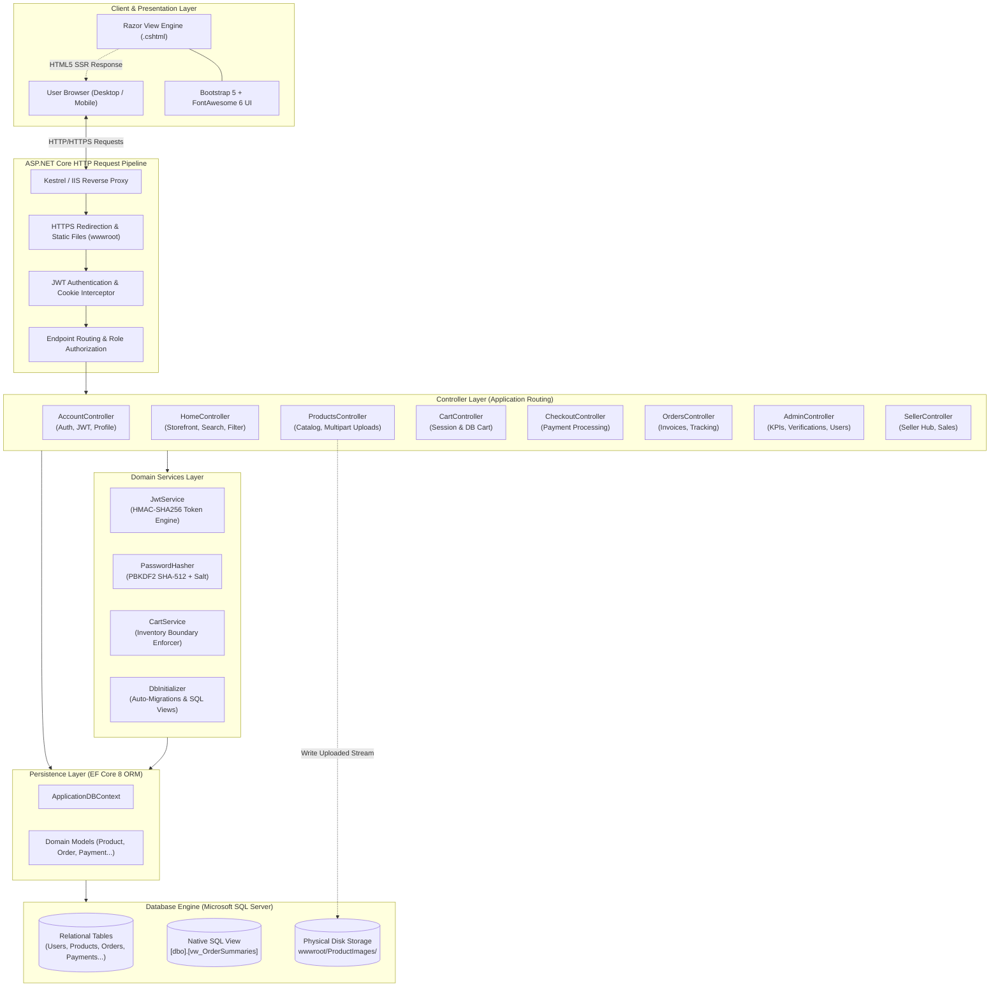
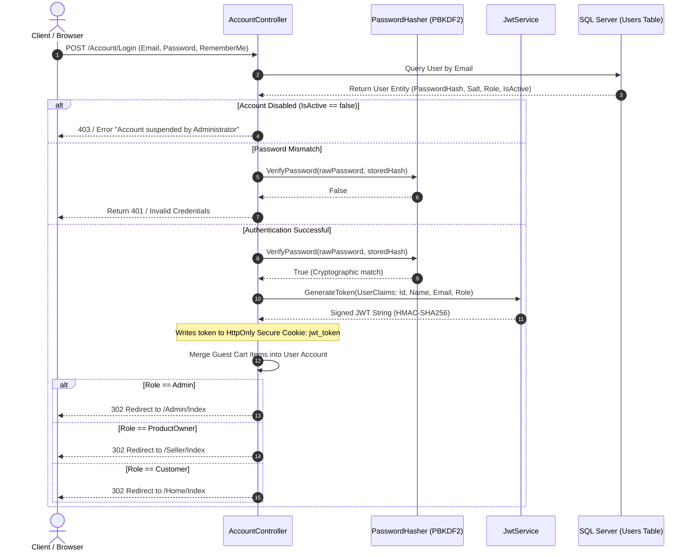
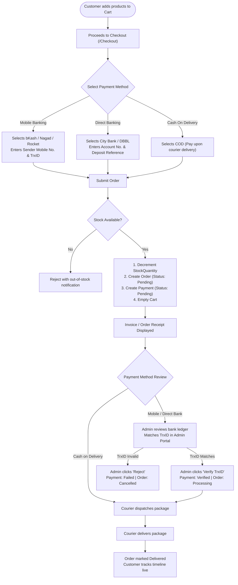
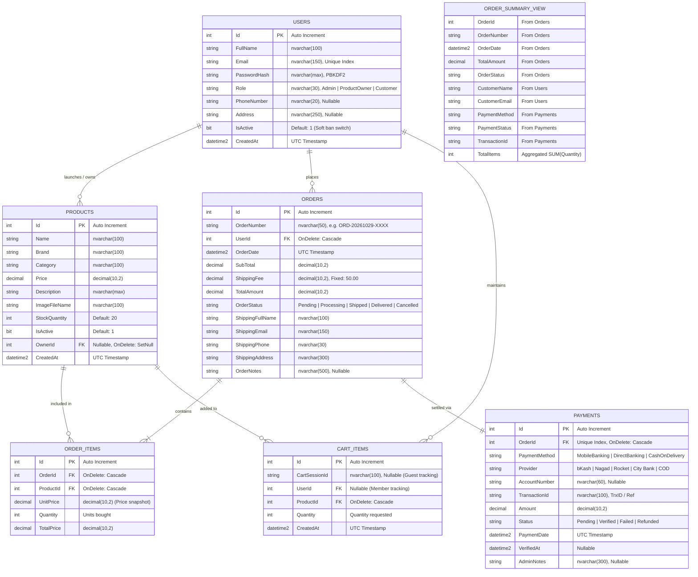

# 🛒 ProductStore — Enterprise Multi-Vendor E-Commerce Platform

[](http://productstore.runasp.net/)
[](https://dotnet.microsoft.com/)
[](https://learn.microsoft.com/aspnet/core)
[](https://learn.microsoft.com/ef/core/)
[](https://www.microsoft.com/sql-server)
[](https://jwt.io/)

A full-stack, enterprise-grade **Multi-Vendor E-Commerce Web Application** built using **ASP.NET Core 8.0 MVC**, **Entity Framework Core 8**, **Microsoft SQL Server**, and **cryptographic JSON Web Token (JWT) Authentication**. 

The platform supports a 3-tier Role-Based Access Control model (**Master Admin**, **Product Owner / Merchant**, and **Customer**), inventory synchronization, shopping cart state management, and a versatile **multi-channel payment system** (Mobile Banking via bKash, Nagad, Rocket with TrxID audit verification, Direct Bank Wire Transfers, and Cash on Delivery).

---

## 🌐 Live Production Deployment

* **Production URL**: [http://productstore.runasp.net](http://productstore.runasp.net/)
* **Database Host**: MonsterASP.NET Managed Microsoft SQL Server (`db76499.databaseasp.net`)
* **Environment**: Windows Server IIS + ASP.NET Core Hosting Bundle

### Pre-Configured Test Personas

You can test any role directly using the credentials below:

| Persona | Email | Password | Permissions & Dashboard |
| :--- | :--- | :--- | :--- |
| 🛡️ **Master Admin** | `admin@productstore.com` | `Admin@123` | Full platform control: revenue analytics, 1-click TrxID verification, user banning, role elevation, and SQL View reports. |
| 🏪 **Product Owner** | `seller@productstore.com` | `Seller@123` | Seller Hub: launch products, stock management, tenant data isolation, and customer sales order tracking. |
| 🛍️ **Customer** | `customer@productstore.com` | `Customer@123` | Storefront catalog, dynamic shopping cart, multi-channel checkout (bKash/Bank/COD), and live order tracking. |

> [!TIP]
> The login screen at `http://productstore.runasp.net/Account/Login` includes **1-click quick-fill profile buttons** to instantly log in as Admin, Seller, or Customer without typing.

---

## 📑 Table of Contents

- [System Architecture](#-system-architecture)
- [Authentication & Security Flow](#-authentication--security-flow)
- [Order & Multi-Channel Payment Lifecycle](#-order--multi-channel-payment-lifecycle)
- [Database Entity-Relationship (ER) Diagram](#-database-entity-relationship-er-diagram)
- [Role-Based Access Control (RBAC) Matrix](#-role-based-access-control-rbac-matrix)
- [Technology Stack & Architectural Rationale](#-technology-stack--architectural-rationale)
- [Project Directory Structure](#-project-directory-structure)
- [REST API Endpoints](#-rest-api-endpoints)
- [Local Development Setup](#-local-development-setup)
- [Database Migrations & SQL Views](#-database-migrations--sql-views)
- [License & Authors](#-license--authors)

---

## 🏛️ System Architecture

ProductStore follows the **Layered Clean MVC Architecture**, enforcing separation of concerns between client presentation, HTTP controllers, application business domain services, and database persistence.



---

## 🔐 Authentication & Security Flow

The platform utilizes a **Hybrid JWT Architecture**:
* **JSON Web Tokens (HMAC-SHA256)** are generated upon login and stored in an `HttpOnly`, `SameSite=Lax` secure cookie.
* This allows standard browser navigation, form submissions, and page refreshes to remain seamlessly authenticated without requiring client-side JavaScript headers on every link.
* Concurrently, the token is returned in REST API responses for external integrations.



### Password Hashing Specification
* **Algorithm**: PBKDF2 (Password-Based Key Derivation Function 2)
* **Underlying PRF**: HMAC-SHA512
* **Salt**: 128-bit (16 bytes) cryptographically secure random entropy via `RandomNumberGenerator`
* **Iteration Count**: 100,000 rounds
* **Comparison**: Constant-time execution via `CryptographicOperations.FixedTimeEquals` to eliminate side-channel timing attacks.

---

## 💳 Order & Multi-Channel Payment Lifecycle



---

## 🗄️ Database Entity-Relationship (ER) Diagram

The relational schema is managed through Entity Framework Core Code-First migrations with referential integrity constraints, unique indexes, and cascading behaviors.



---

## 👥 Role-Based Access Control (RBAC) Matrix

| Feature / Action | Anonymous Guest | Customer | Product Owner (Seller) | Master Admin |
| :--- | :---: | :---: | :---: | :---: |
| **Browse Catalog, Filter & Search** | ✅ | ✅ | ✅ | ✅ |
| **Add to Cart & Session Persistence** | ✅ | ✅ | ✅ | ✅ |
| **Checkout & Submit Payments** | ❌ (Prompts Login) | ✅ | ✅ | ✅ |
| **View Personal Orders & Invoices** | ❌ | ✅ | ✅ | ✅ |
| **Update Personal Profile / Address** | ❌ | ✅ | ✅ | ✅ |
| **Seller Hub (Sales Analytics)** | ❌ | ❌ | ✅ | ✅ |
| **Launch Products (With File Upload)** | ❌ | ❌ | ✅ | ✅ |
| **Edit/Delete Owned Products** | ❌ | ❌ | ✅ (Own Only) | ✅ (All) |
| **1-Click TrxID Payment Verification** | ❌ | ❌ | ❌ | ✅ |
| **Update Order Fulfillment Status** | ❌ | ❌ | ❌ | ✅ |
| **User Ban / Activation Toggle** | ❌ | ❌ | ❌ | ✅ |
| **User Role Elevation / Demotion** | ❌ | ❌ | ❌ | ✅ |
| **Query Database View Reports** | ❌ | ❌ | ❌ | ✅ |

---

## 🛠️ Technology Stack & Architectural Rationale

| Category | Technology | Rationale |
| :--- | :--- | :--- |
| **Runtime & Core** | **.NET 8 LTS (C# 12)** | Long Term Support, optimal JIT compilation throughput, modern asynchronous pipelines (`async`/`await`). |
| **Web Framework** | **ASP.NET Core MVC** | Clean Model-View-Controller abstraction, strongly typed Razor views, Tag Helpers, and built-in Dependency Injection. |
| **Database ORM** | **Entity Framework Core 8** | High-performance ORM supporting Code-First migrations, Linq-to-Entities query translation, and native Keyless Views. |
| **Database Engine** | **Microsoft SQL Server** | Enterprise relational DBMS, ACID transaction guarantees, clustered primary keys, and view materialization. |
| **Authentication** | **JWT Bearer + PBKDF2** | Cryptographic token signing (HMAC-SHA256) combined with `HttpOnly` cookie delivery to defeat Cross-Site Scripting (XSS). |
| **Frontend Styling** | **Bootstrap 5.3 + FontAwesome 6** | Mobile-first responsive grid system, flexible modal dialogs, and SVG icon telemetry without heavy JavaScript dependencies. |
| **Containerization** | **Multi-Stage Dockerfile** | Self-contained Linux container compilation (`mcr.microsoft.com/dotnet/sdk:8.0` build ➔ `dotnet/aspnet:8.0` runtime). |

---

## 📁 Project Directory Structure

```text
ProductStore/
├── .github/                       # CI/CD Workflows
├── ProductStore/                  # Main Web Project Root
│   ├── Controllers/               # MVC Controllers
│   │   ├── AccountController.cs   # Authentication, Registration, JWT issuing, Profile
│   │   ├── AdminController.cs     # KPI Dashboards, Payment Verification, User Management
│   │   ├── CartController.cs      # Cart additions, quantity updates, badge counter
│   │   ├── CheckoutController.cs  # Mobile Banking, Direct Bank, COD processing
│   │   ├── HomeController.cs      # Catalog landing page, search, filtering
│   │   ├── OrdersController.cs    # Customer order history, invoice details
│   │   ├── ProductsController.cs  # CRUD catalog operations, file upload handling
│   │   └── SellerController.cs    # Seller inventory tracking, customer sales orders
│   ├── Migrations/                # EF Core Code-First Database Migrations
│   │   ├── 20241205133138_FirstMigration.cs
│   │   └── 20261027182317_AddEcommerceAndAuth.cs
│   ├── Models/                    # Domain Entities & ViewModels
│   │   ├── CartItem.cs            # Cart model
│   │   ├── Order.cs               # Order model
│   │   ├── OrderItem.cs           # Order line item model
│   │   ├── OrderSummaryView.cs    # Keyless mapping to SQL View vw_OrderSummaries
│   │   ├── Payment.cs             # Multi-channel payment model
│   │   ├── Product.cs             # Database product entity
│   │   ├── ProductDto.cs          # Form Data Transfer Object with IFormFile
│   │   ├── User.cs                # User account entity with Role constants
│   │   └── ViewModels/            # Strongly-typed presentation ViewModels
│   ├── Properties/                # Launch settings and Web Deploy profiles
│   ├── Services/                  # Application Domain Services
│   │   ├── ApplicationDBContext.cs# EF Core DbContext with Fluent API rules
│   │   ├── CartService.cs         # Cart state & guest-to-member merger
│   │   ├── DbInitializer.cs       # Auto-migration, SQL View creator, seed engine
│   │   ├── JwtService.cs          # HMAC-SHA256 JWT Token generator & validator
│   │   └── PasswordHasher.cs      # PBKDF2 SHA-512 cryptographic hasher
│   ├── Views/                     # Razor Presentation Views (.cshtml)
│   │   ├── Account/               # Login, Register, Profile, AccessDenied
│   │   ├── Admin/                 # Dashboard, Orders, Users, SQL Reports
│   │   ├── Cart/                  # Shopping cart view with quantity selectors
│   │   ├── Checkout/              # Multi-channel payment checkout & invoice
│   │   ├── Home/                  # Storefront showcase
│   │   ├── Orders/                # Order history and printable invoices
│   │   ├── Products/              # Details, Create, Edit, Index
│   │   ├── Seller/                # Seller inventory hub & customer sales
│   │   └── Shared/                # Master _Layout.cshtml with dynamic cart badge
│   ├── wwwroot/                   # Web Root (Static Files)
│   │   ├── css/ & js/             # Custom site styling and client scripts
│   │   └── ProductImages/         # Uploaded product image files
│   ├── appsettings.json           # Production configuration & connection strings
│   ├── appsettings.Development.json # Local development connection overrides
│   ├── Program.cs                 # Application bootstrap, DI container, Middleware
│   └── ProductStore.csproj        # Dependencies & compilation target (.NET 8)
├── Dockerfile                     # Multi-stage production container manifest
├── ProductStore.sln               # Solution manifest
└── README.md                      # Enterprise documentation
```

---

## 📡 REST API Endpoints

While designed as a Server-Side Rendered (SSR) MVC application, the platform exposes headless REST APIs for client scripts or mobile consumers:

| Method | Endpoint | Authorization | Description |
| :--- | :--- | :--- | :--- |
| `POST` | `/api/auth/login` | Public | Authenticates credentials and returns raw `{ success, token, role, fullName }` JSON. |
| `GET` | `/Cart/Count` | Public | Returns real-time cart badge item count `{ count: X }` JSON. |
| `POST` | `/Cart/AddToCart` | Public (AJAX) | Asynchronously appends item to cart without refreshing page. |

---

## 💻 Local Development Setup

### Prerequisites
* [.NET 8.0 SDK](https://dotnet.microsoft.com/download/dotnet/8.0)
* [Microsoft SQL Server](https://www.microsoft.com/sql-server) (LocalDB, Express, or Developer edition)
* [Visual Studio 2022](https://visualstudio.microsoft.com/) or [Visual Studio Code](https://code.visualstudio.com/)

### 1. Clone & Restore
```bash
git clone https://github.com/Bahar0900/Productstore.git
cd Productstore
dotnet restore
```

### 2. Configure Database Connection
Review `ProductStore/appsettings.Development.json` to verify your local SQL Server instance:
```json
{
  "ConnectionStrings": {
    "defaultConnection": "Data Source=.;Initial Catalog=productstoreDB;Integrated Security=True;Trust Server Certificate=True"
  }
}
```

### 3. Run Migrations & Start Server
```bash
# Apply migrations to create the local database
dotnet ef database update --project ProductStore

# Run the development server
dotnet run --project ProductStore
```

The application will start listening at:
* **HTTP**: `http://localhost:5246`
* **HTTPS**: `https://localhost:7178`

---

## 📄 License & Authors

* **Repository**: [https://github.com/Bahar0900/Productstore](https://github.com/Bahar0900/Productstore)
* **Author**: Md. Sagor Chowdhury ([@Bahar0900](https://github.com/Bahar0900))
* **License**: MIT Open Source License
